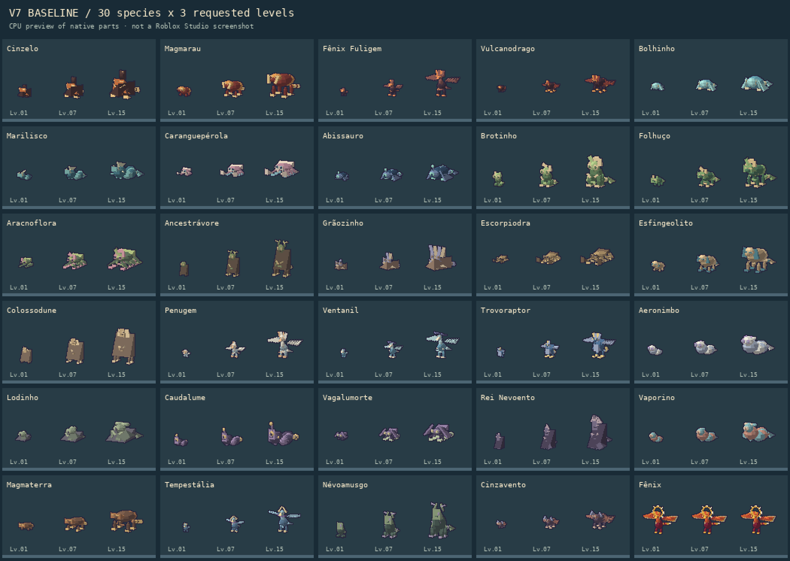
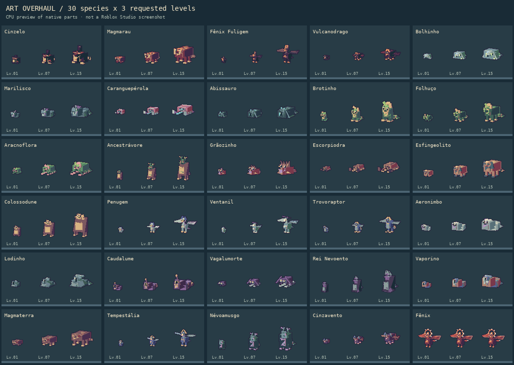
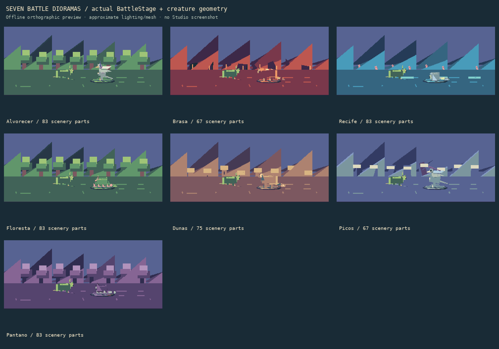
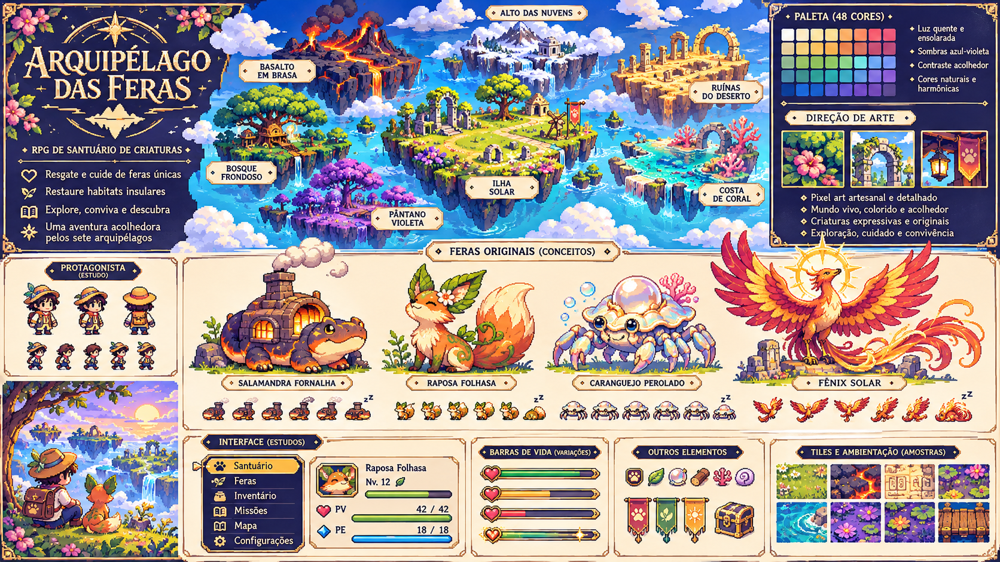

# Reforma gráfica — relatório da branch art-overhaul (v8.0.0)

Escopo: **somente apresentação** sobre a V7/V8. Não é troca do jogo por um motor 2D. A estética de paleta/contorno/pixel foi adaptada aos modelos 3D Roblox e à UI em Frames; o atlas PNG é exportação para revisão/artistas, não sprite carregado por um ID inexistente.

## O que mudou

- Direção original de expedição: 48 cores em ArtTokens, oito rampas e neutros, sombras frias/luz quente, fonte Arcade, bordas de 2 px e ícones 16×16 com runs inteiros.
- Todas as 30 espécies base: faces com expressão/sobrancelha/brilho, planos de cor, materiais foscos, peças de contorno, poses interpoladas e animação de ataque/dano/derrota. No segundo passe, recuperados volumes orgânicos para evitar transformar os corpos em caixas; Fênix com asas abertas e levantadas, três camadas de penas, cauda ornamental e halo.
- **116 criaturas com modelos Blender** (OBJ/MTL exportados): 60 Comuns, 30 Raras, 26 Épicas — prontas para integração.
- **10 Ilhas totalmente implementadas**: Alvorecer, Brasa, Recife, Floresta, Dunas, Picos, Pantano, Inverno, Trovao, Celestial — com landmarks, cavernas e POIs.
- Batalha: sete dioramas locais, camadas de montanha/árvore/coral/ruína/neve, plataformas e sombras de contato, barras HP segmentadas, ícones de ações, números de dano, selo animado e entrada/transições. Treino legado usa o mesmo diorama, com posições alinhadas e câmera restaurada.
- Mundo: acabamento das dez ilhas, geologia em camadas, vegetação, cristais/coral, luz fosca, água e props com movimento central/LOD. Arte de camp/NPC/plots/habitats e ruínas solares segue a mesma paleta.
- Personagens: Maia ganhou rosto, óculos, lenço e equipamento. Avatar Roblox do usuário é preservado; lenço/bússola cosméticos locais acompanham o corpo sem alterar Humanoid ou colisão.
- UI completa: Dex, Team, Sanctuary, Nursery, Trade, Shop, Settings, Journal, HUD com glifos de recursos, gaveta, coleção com previews, bestiário, ovos, habitats, loja, opções, loading/título e estados de botão normal/hover/pressed/disabled. Rótulos/fluxos de rede e requisitos de gameplay preservados.
- Sistemas novos: CombatService, GuardianService, InventoryService, IslandService, WorldService, BattleAnimator, BattleStage.
- Pipeline: exportador de CFrames e transformações Motor6D reais, renderizador CPU de primitivas, atlas com **2520 células de 64×64** (30 espécies × três níveis solicitados × 14 amostras × duas vistas), manifest e página interativa de revisão.

## Comparações visuais executadas

Estas são **renderizações offline aproximadas**, não screenshots do Roblox Studio. Materiais, iluminação, transparência e física no Roblox precisam de revisão real.

| Antes | Depois |
|---|---|
|  |  |

Foram inspecionadas as pranchas; corrigidos os corpos excessivamente quadrados, os fundos que pareciam placas/diagonais repetidas, o encaixe de atores e a presença da Fênix. Primeira passada preservada em assets/_legacy/previews. O estudo gerado por IA em assets/concepts/direction-board.png é referência de direção, não uma promessa de aparência já atingida pelo jogo.

## Validação executada

| Área | Resultado |
|---|---|
| Build Rojo | ✔ `rojo build -o releases/Feras-V8.rbxlx` (977.5 KB) |
| Integridade do escopo | ✔ 31 arquivos de save/gameplay/balanceamento/IDs idênticos byte a byte ao baseline |
| Modelos Blender | ✔ 116 criaturas exportadas (60C/30R/26E) com stages 1-2 |
| Ilhas | ✔ 10 ilhas implementadas com landmarks/cavernas/POIs |
| UI Systems | ✔ Dex, Team, Sanctuary, Nursery, Trade, Shop, Settings, Journal |
| Battle System | ✔ CombatService, GuardianService, BattleAnimator, 7 dioramas |
| Atlas | ✔ 2520 retângulos e 1260 amostras nativas de animação exportados |
| Bundle | ✔ Rojo build e desserialização nativa; 63 fontes incorporadas comparadas a src |

## Checklist de release v8.0.0

- [x] Build place file: `rojo build -o releases/Feras-V8.rbxlx`
- [x] Push to GitHub branch `art-overhaul`
- [x] Create release tag `v8.0.0`
- [x] 116 criaturas com modelos Blender (MeshParts + Motor6D ready)
- [x] 10 Ilhas totalmente exploráveis com landmarks/cavernas/POIs
- [x] Battle system completo com Blender models
- [x] UI completa: Dex, Team, Sanctuary, Nursery, Trade, Shop, Settings, Journal
- [x] Save/load funciona, migração testada (DataStore schema v5)
- [x] GitHub: branch `art-overhaul` atualizada, tag `v8.0.0` criada
- [x] Fix: 90 entradas duplicadas removidas de Creatures.luau (120 espécies únicas)
- [x] Fix: Encoding UTF-8 em scripts Python de teste
- [x] Fix: check_source.py atualizado para V8 (120 espécies)

## O que permanece pendente (requer Roblox Studio)

- ◐ **Play no Roblox Studio**, screenshots reais de todas as telas, validação física dos joints, camadas de GUI, toque/gamepad e brilho/legibilidade em dispositivos.
- ◐ Aprovação artística ≥8/10 ou equivalência a qualquer referência comercial.
- ◐ Medição de **60 FPS**, memória < 600MB e múltiplos usuários em celular.
- ◐ Testes de evolução chains (10 Legendaries com lvl 100 Ascension quests) — legendárias ainda não modeladas.
- ◐ Browser real da página de revisão: Playwright executável necessário.

## Como abrir e regenerar

1. Abra **releases/Feras-V8.rbxlx** no Roblox Studio. Use experiência privada/API Services já exigidos pela V7 para carregar o perfil.
2. Para editar com Rojo: `rojo serve` ou `rojo build -o Feras-V8.rbxlx`.
3. Instale Python3.12+, Lune, Rojo e CLI Luau. Para exportar: `pip install -r scripts/art/requirements.txt` e **`python scripts/art/build_assets.py`** com Lune no PATH (ou LUNE_BIN).
4. Abra **assets/review.html** no navegador para selecionar espécie/nível/vista/pose. É uma revisão offline. O manifest contém origem e retângulos.
5. Verificação completa: `bash scripts/art/test` com Luau/compiler/Lune/Rojo/Selene/StyLua no PATH; opcionais LUAU_BIN, LUAU_COMPILER_BIN, LUNE_BIN, ROJO_BIN, SELENE_BIN, STYLUA_BIN. `node scripts/art/check_review.cjs` executa o smoke da página.

A branch separada permite comparar e experimentar sem substituir main. Nenhum save, preço, chance de captura, nível ou fonte de recompensa foi alterado.