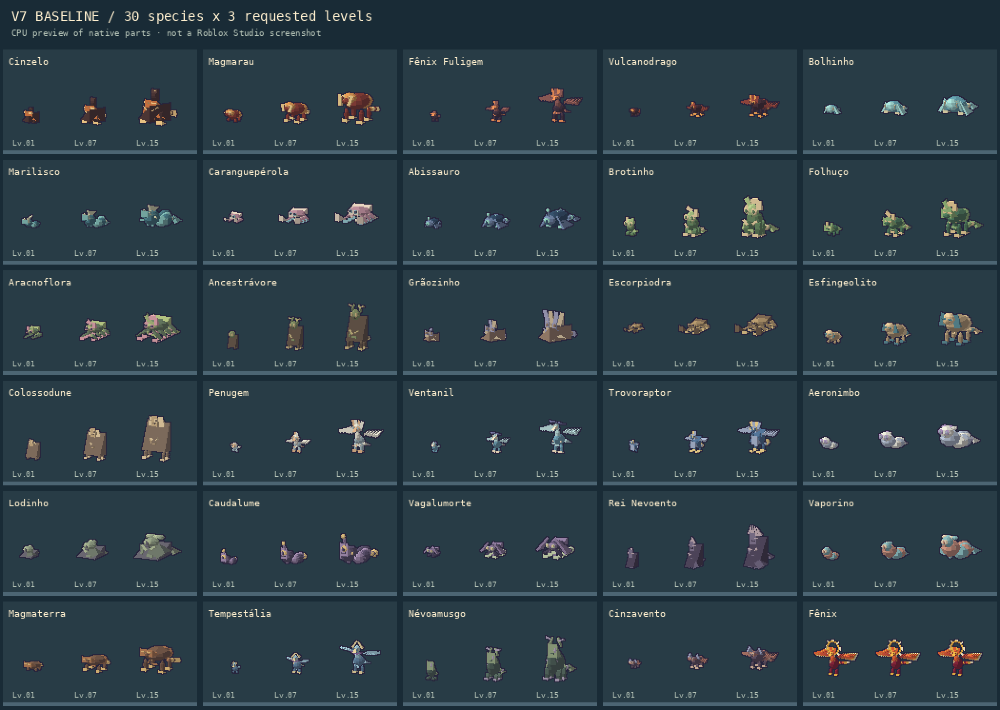
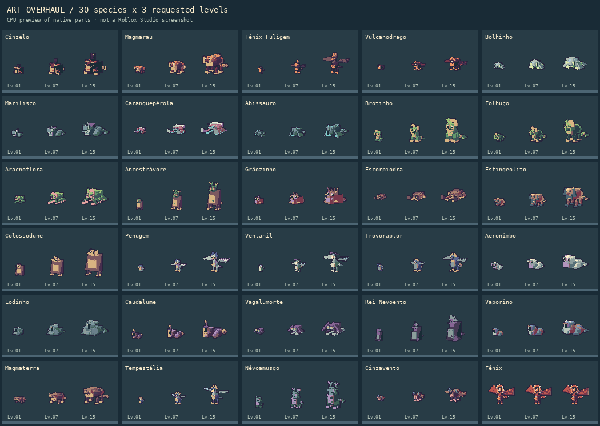
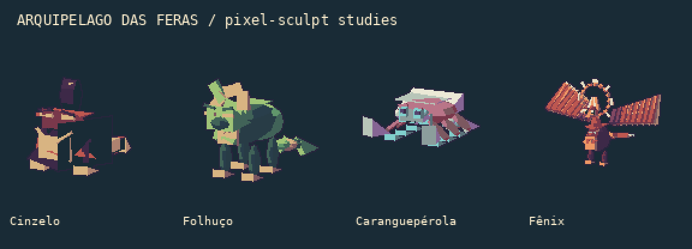
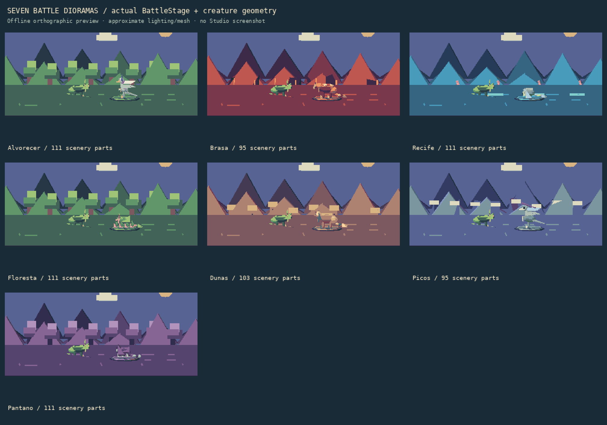
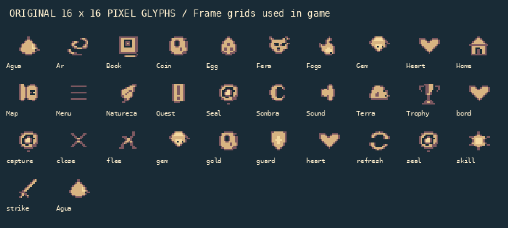

# Reforma gráfica — relatório da branch art-overhaul

Escopo: **somente apresentação** sobre a V7. Não é troca do jogo por um motor 2D. A estética de paleta/contorno/pixel foi adaptada aos modelos 3D Roblox e à UI em Frames; o atlas PNG é exportação para revisão/artistas, não sprite carregado por um ID inexistente.

## O que mudou

- Direção original de expedição: 48 cores em ArtTokens, oito rampas e neutros, sombras frias/luz quente, fonte Arcade, bordas de 2 px e ícones 16×16 com runs inteiros.
- Todas as 30 espécies: faces com expressão/sobrancelha/brilho, planos de cor, materiais foscos, peças de contorno, poses interpoladas e animação de ataque/dano/derrota. No segundo passe, recuperados volumes orgânicos para evitar transformar os corpos em caixas; Fênix com asas abertas e levantadas, três camadas de penas, cauda ornamental e halo.
- Batalha: sete dioramas locais, camadas de montanha/árvore/coral/ruína/neve, plataformas e sombras de contato, barras HP segmentadas, ícones de ações, números de dano, selo animado e entrada/transições. Treino legado usa o mesmo diorama, com posições alinhadas e câmera restaurada.
- Mundo: acabamento das sete ilhas, geologia em camadas, vegetação, cristais/coral, luz fosca, água e props com movimento central/LOD. Arte de camp/NPC/plots/habitats e ruínas solares segue a mesma paleta.
- Personagens: Maia ganhou rosto, óculos, lenço e equipamento. Avatar Roblox do usuário é preservado; lenço/bússola cosméticos locais acompanham o corpo sem alterar Humanoid ou colisão.
- UI: HUD com glifos de recursos, gaveta, coleção com previews, bestiário, ovos, habitats, loja, opções, loading/título e estados de botão normal/hover/pressed/disabled. Rótulos/fluxos de rede e requisitos de gameplay preservados.
- Pipeline: exportador de CFrames e transformações Motor6D reais, renderizador CPU de primitivas, atlas com **2520 células de 64×64** (30 espécies × três níveis solicitados × 14 amostras × duas vistas), manifest e página interativa de revisão.

## Comparações visuais executadas

Estas são **renderizações offline aproximadas**, não screenshots do Roblox Studio. Materiais, iluminação, transparência e física no Roblox precisam de revisão real.

| Antes | Depois |
|---|---|
|  |  |

Foram inspecionadas as pranchas; corrigidos os corpos excessivamente quadrados, os fundos que pareciam placas/diagonais repetidas, o encaixe de atores e a presença da Fênix. Primeira passada preservada em assets/_legacy/previews. O estudo gerado por IA em assets/concepts/direction-board.png é referência de direção, não uma promessa de aparência já atingida pelo jogo.

## Validação executada

| Área | Resultado |
|---|---|
| Regressão da V7 | ✔ suites antigas e V7; comandos integrais em art/TEST_RESULTS.txt |
| Sintaxe e lint | ✔ compilador Luau; Selene zero erros/avisos; StyLua check |
| Integridade do escopo | ✔ **31 arquivos** de save/gameplay/balanceamento/IDs idênticos byte a byte ao baseline publicado; art/GAMEPLAY_UNCHANGED.json |
| Modelos | ✔ 91 construções, orçamento 28/48/80 e Fênix170 preservado; menor distância 0.14722 >0,12 |
| Cena de 40 criaturas | ✔ 1482 peças <3200; contagem, não FPS |
| Cenários de batalha | ✔ sete, 95–111 peças, todas cenográficas sem colisão/query/touch; origem deslocada do treino testada |
| Mundo e roupa | ✔ 585 props, 203 peças de geologia e 64 peças de acabamento; roupa com quatro peças soldadas massless; propriedades Humanoid inalteradas |
| UI | ✔ 48 cores únicas, todos os grids 16×16, máximo 92 runs por ícone; estados de botão e callback único em sinais simulados; alvo44 px |
| Atlas | ✔ 2520 retângulos e 1260 amostras nativas de animação exportados; frente/costas; revisão JS smoke com 720 combinações em DOM simulado |
| Bundle | ✔ Rojo build e desserialização nativa; 63 fontes incorporadas comparadas a src |

## O que permanece pendente

- ◐ **Play no Roblox Studio**, screenshots reais de todas as telas, validação física dos joints, camadas de GUI, toque/gamepad e brilho/legibilidade em dispositivos. Este Linux não tem Studio; não se marcou essa etapa como executada.
- ◐ Aprovação artística ≥8/10 ou equivalência a qualquer referência comercial. A direção foi implementada e inspecionada offline; não há prova de que essa meta subjetiva foi atingida.
- ◐ Medição de **60 FPS**, memória e múltiplos usuários em celular. LOD/budgets testados não provam framerate.
- ◐ Conversão integral para sprites 2D/tiles de pixel art em runtime. Isso alteraria a apresentação estrutural e exigiria publicação de imagens no Roblox. O jogo segue 3D; os PNGs de exportação não são carregados pelo runtime.
- ◐ Browser real da página de revisão: Playwright está instalado, mas a versão gerenciada não tinha executável; Chromium do sistema encerrou por restrição de socket/crashpad. O JavaScript foi exercitado via DOM simulado, sem afirmar screenshot de navegador.

## Como abrir e regenerar

1. Abra **releases/Feras-Art-Overhaul.rbxlx** no Roblox Studio. Use experiência privada/API Services já exigidos pela V7 para carregar o perfil. O bundle V7 anterior foi preservado como histórico.
2. Para editar com Rojo: `rojo serve` ou `rojo build -o Feras-Art.rbxlx`.
3. Instale Python3.12+, Lune, Rojo e CLI Luau. Para exportar: `pip install -r scripts/art/requirements.txt` e **`python scripts/art/build_assets.py`** com Lune no PATH (ou LUNE_BIN).
4. Abra **assets/review.html** no navegador para selecionar espécie/nível/vista/pose. É uma revisão offline. O manifest contém origem e retângulos.
5. Verificação completa: `bash scripts/art/test` com Luau/compiler/Lune/Rojo/Selene/StyLua no PATH; opcionais LUAU_BIN, LUAU_COMPILER_BIN, LUNE_BIN, ROJO_BIN, SELENE_BIN, STYLUA_BIN. `node scripts/art/check_review.cjs` executa o smoke da página.

A branch separada permite comparar e experimentar sem substituir main. Nenhum save, preço, chance de captura, nível ou fonte de recompensa foi alterado.
